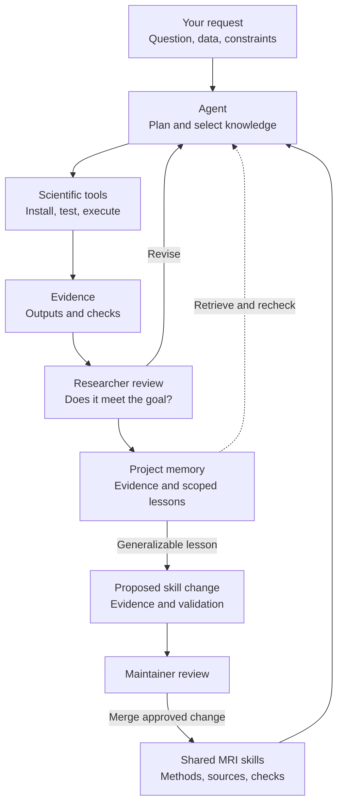

<div align="center" id="top">

<h1>
  <picture>
    <source media="(prefers-color-scheme: dark)" srcset="assets/mrfoundry-logo-dark.svg">
    <source media="(prefers-color-scheme: light)" srcset="assets/mrfoundry-logo-light.svg">
    
  </picture>
</h1>

**AI for MRI science — from research questions to new knowledge.**

[](https://github.com/KeWang0622/MRFoundry/actions/workflows/validate.yml) [](LICENSE)  [](https://github.com/KeWang0622/MRFoundry)

</div>

<p align="center">
<a href="#quick-start">Quick start</a> · <a href="#toward-new-mri-discoveries">Scientific discovery</a> · <a href="#recursive-self-improvement">Self-improvement</a> · <a href="#choose-your-skills">Skills</a> · <a href="REFERENCES.md">References</a> · <a href="https://kewang0622.github.io/slides/mrfoundry/">Tutorial</a> · <a href="#contributing">Contribute</a>
</p>

**MRFoundry is an open-source skill package for research agents working across MRI physics, acquisition, reconstruction and analysis.** It connects domain knowledge with scientific tools, experiment checks and project memory, helping a coding agent carry a research question through to evidence and a reproducible report.

The researcher sets the question and evaluates the findings. The agent plans, executes, checks and revises the work. Lessons from that work can guide the next experiment and, after review, improve the shared skill package. This connects **AI-assisted research** with **researcher-guided recursive self-improvement (RSI)**.

Our long-term goal is to **expand what MRI research can discover**: help researchers formulate new hypotheses, develop methods and test ideas that connect acquisition, reconstruction and analysis. Reliable scientific execution supplies the experimental foundation for that work.

**Domain knowledge · Scientific tool use · Research memory · Reviewed skill improvement**

## Quick start

Install with the open [skills CLI](https://github.com/vercel-labs/skills), then select the skills and supported coding agents you want to use:

```bash
npx skills add KeWang0622/MRFoundry -g
```

Start with a request in your agent:

> Design a golden-angle radial gradient-echo in PyPulseq and simulate it first. Then reconstruct the simulated data and check whether the image meets the research goal.

The skills guide tool selection, setup, execution and checks. Scientific applications such as PyPulseq, KomaMRI and BART are installed separately as needed; the agent is instructed to handle routine setup in an isolated environment and test an upstream example before use.

**[Explore the interactive tutorial →](https://kewang0622.github.io/slides/mrfoundry/)** — agents, skills, MRI examples and the self-improvement workflow.

<details>
<summary>Install one skill, choose an agent, or update</summary>

```bash
# Install only for the current project
npx skills add KeWang0622/MRFoundry

# Choose one skill
npx skills add KeWang0622/MRFoundry --skill mri-reconstruction

# Target a supported agent
npx skills add KeWang0622/MRFoundry -a claude-code

# Browse without installing
npx skills add KeWang0622/MRFoundry --list

# Update installed global skills
npx skills update -g
```

Choose individual skills or the full package. Browse the [skills directory](https://github.com/KeWang0622/MRFoundry/tree/main/skills). These are Markdown instructions and supporting helpers; installing them does not install every scientific application or grant access to restricted datasets.

</details>

## How it works

**You set the research goal. The agent combines skills and uses scientific tools to investigate it.** MRFoundry supplies reusable instructions, references and helper scripts that connect these steps.



Tools include **PyPulseq** for sequence definitions, **KomaMRI** for simulation, **BART / SigPy** for reconstruction, and **MRtrix3 / DIPY** for diffusion analysis. Data resources and papers supply inputs and evidence; skills help the agent choose and use them.

### Research phases

| Phase | What the agent helps with | What to inspect |
|---|---|---|
| **1 · Frame the question** | Read primary literature, identify the gap, combine relevant skills. | A specific question, assumptions and success criteria. |
| **2 · Design the study** | Choose data, acquisition or simulation, baselines and metrics. | A feasible plan with controls and comparison conditions. |
| **3 · Run the work** | Set up established tools; simulate, reconstruct or analyze. | Commands, versions, outputs and failed attempts. |
| **4 · Evaluate the evidence** | Inspect images and results; test assumptions, accuracy and robustness. | Whether the result supports the claim—not just whether code ran. |
| **5 · Write and improve** | Draft figures and methods; record scoped lessons for the next task. | Traceable claims, limitations and reusable project knowledge. |

These phases are iterative. New evidence or user feedback can send the work back to an earlier decision. The [research-workflow skill](skills/mri-research-workflow/SKILL.md) connects the phases; specialist skills supply the domain guidance.

## Toward new MRI discoveries

**A useful research agent should help decide what to investigate next.** MRFoundry's discovery direction connects literature and project evidence to competing hypotheses, experiments that distinguish them, and methods that can be independently checked.

| Research objective | Evidence to seek |
|---|---|
| **Execute an established method** | Correct, reproducible artifacts and task-specific checks. |
| **Improve a method** | A meaningful gain over strong baselines under declared constraints, confirmed on held-out cases. |
| **Establish new knowledge** | A finding or method assessed against prior work, supported by discriminating experiments and independent validation. |

For example, a researcher could investigate which acquisition and reconstruction choices improve quantitative estimates at a fixed scan time, or which experiment best distinguishes two explanations of a measurement bias. These are starting questions for a study; their originality and value need a literature review and experimental evidence.

The current benchmark evaluates executable tasks. Method improvement and discovery are the next evaluation directions, with their own evidence requirements. See the **[AI-for-science research agenda](docs/AI-FOR-SCIENCE.md)** and start a project with the **[research brief](docs/templates/research-brief.md)**.

## Choose your skills

Start with **mri-research** for orientation, **mri-research-workflow** for a study, or a specialist for a focused task. The current collection is a starting point: new methods, tools and research areas can enter through reviewed contributions.

| Skill | Use it for | Typical tools or resources |
|---|---|---|
| [MRI research](skills/mri-research/SKILL.md) | Physics, references, cross-domain questions and image-level analysis | Courses, papers, BIDS, FSL, FreeSurfer |
| [Research workflow](skills/mri-research-workflow/SKILL.md) | Question → study design → experiments → manuscript | Literature, baselines, metrics, venue guidance |
| [Reconstruction](skills/mri-reconstruction/SKILL.md) | Raw k-space, coil maps, parallel imaging, compressed sensing, non-Cartesian recon | BART, SigPy, ISMRMRD |
| [Sequence design](skills/pulse-sequence-design/SKILL.md) | GRE, SE/FSE, EPI, diffusion preparation, DENSE and simulation | Pulseq/PyPulseq, KomaMRI, vendor references |
| [Deep-learning reconstruction](skills/deep-learning-recon/SKILL.md) | Trained, unrolled, self-supervised and diffusion-based recon | DIRECT, ATOMMIC, fastMRI |
| [Diffusion MRI](skills/diffusion-mri/SKILL.md) | DWI/DTI, ADC/FA/MD, preprocessing, fiber orientations and tractography | MRtrix3, DIPY, FSL, QSIPrep |
| [Hardware](skills/mri-hardware/SKILL.md) | Coils, gradients, low-field systems, shimming and safety orientation | MaRCoS, OCRA, EM and shim tools |

### Explore the expanded guides

- **[DWI and DTI](skills/diffusion-mri/references/dwi-dti.md):** from diffusion-weighted volumes and gradient tables to tensor maps, quality checks and interpretation.
- **[Sequence families, EPI and DENSE](skills/mri-research/references/sequences-and-trajectories.md#sequence-families-contrast-encoding-and-readout):** what each measures, what to validate, and which established examples/tools to use.
- **[Journals, conferences and paper summaries](skills/mri-research/references/publishing.md):** MRM, MICCAI, ISMRM, CVPR and related venues; contribution fit and a reproducible literature-digest workflow.

## Research memory

Each project can keep a private **`.mrfoundry/`** notebook. The improvement loop is **retrieve → execute → evaluate → update → reuse and verify**.

```text
.mrfoundry/
├── INDEX.md          # Relevant work and next steps
├── preferences.md    # Your explicit research habits
├── environment.md    # Working tools, versions and setup checks
├── runs/             # Experiments, outcomes and failures
└── lessons.md        # Reusable findings with evidence and limits
```

A lesson should change a concrete decision in the next task, then be checked again. Keep user preferences separate from scientific conclusions, and retain failed or superseded findings. Project `CLAUDE.md` / `AGENTS.md` can point agents to the notebook. The [initializer](skills/mri-research/scripts/init_research_memory.py) creates the notebook and preserves existing notes; the researcher and agent maintain its contents during the work.

Existing `.mri-research/` notebooks migrate to `.mrfoundry/` with the same initializer; existing notes are preserved. If both folders exist, reconcile them before migrating.

[Set up project memory →](skills/mri-research/references/project-memory.md) · [How agents set up scientific tools →](skills/mri-research/references/tool-setup.md)

## Recursive self-improvement

**Research produces evidence; evidence can improve the guidance used for the next research task.** In MRFoundry, RSI operates through project knowledge and reusable skills, with people reviewing scientific conclusions and shared changes.

| Loop | What changes | How it is checked |
|---|---|---|
| **Within a study** | The plan, parameters or implementation | Inspect outputs and revise against the research question. |
| **Across sessions** | Project memory: environment notes, scoped lessons and open questions | Retrieve a relevant lesson, apply it to a new decision and recheck its assumptions. |
| **Across researchers** | Shared instructions, references or helper scripts | Propose a focused PR with evidence; maintainers review it before other users adopt the update. |

For example, an exported pulse sequence may miss its requested echo time even when the build script uses the intended value. A useful lesson becomes a rule to measure timing from the exported artifact, supported by a regression example. The [improvement guide](docs/SELF-IMPROVEMENT.md) follows this case from a check to a proposed skill update.

These loops improve the knowledge and procedures available to an agent; they do not train its model weights. Each proposed improvement needs evidence of where it helps and where it applies.

## Write an MRI paper

The [paper-writing guide](skills/mri-research-workflow/references/paper-writing.md)
connects **claims → experiment evidence → figures → manuscript → reviewer responses**,
with distinct guidance for **MICCAI, MRM, JMRI and IEEE TMI** and links to official
instructions. Start with an editable [paper plan](skills/mri-research-workflow/assets/paper-plan.md).

> “Use my experiment records to plan an MRM paper. Map each claim to evidence,
> propose the figures, and flag missing analyses before drafting the abstract.”

The included diffusion study is an illustrative planning example, not reported
experimental results. The agent should never fill missing evidence with plausible numbers.

## Try a research question

| Your request | Knowledge the agent needs to combine |
|---|---|
| “Why do my eight receive channels look different, and how can reconstruction use that?” | Coil sensitivity and hardware + reconstruction's encoding model |
| “Design a golden-angle GRE, simulate it, then reconstruct its data.” | Sequence timing + hardware constraints + Bloch simulation + non-Cartesian reconstruction |
| “Plan a reproducible MRI reconstruction study for MRM.” | Literature + data conventions + baselines + evaluation + scientific writing |
| “Could free water explain this change in diffusion metrics?” | Diffusion models + confounds + controlled experiment design |

These are example requests, not prerecorded successful runs. Results depend on the agent, tool access, data and validation.

## Reference library

**[Papers and textbooks by skill →](REFERENCES.md)** — the included skills have an
annotated reading list with full citations, direct source links and the topic
each reference supports.

The hub links to primary papers, courses, datasets and software across MRI. It summarizes when a resource is useful rather than redistributing it.

<details>
<summary>Browse the MRI reference areas</summary>

| Stage | Reference | Covers |
|---|---|---|
| [Foundations](skills/mri-research/references/foundations.md) | [`foundations.md`](skills/mri-research/references/foundations.md) | MR physics / k-space and where to learn — Berkeley EE225E, Stanford EE369B/C, Hornak, MRIquestions, ISMRM, handbooks |
| [Acquisition](skills/mri-research/references/sequences-and-trajectories.md) | [`sequences-and-trajectories.md`](skills/mri-research/references/sequences-and-trajectories.md) | Pulseq/PyPulseq, vendor SDKs, trajectory & RF design, SMS, field mapping, GIRF, simulation |
| [Hardware](skills/mri-research/references/hardware.md) | [`hardware.md`](skills/mri-research/references/hardware.md) | Low-field, open consoles, coil/shim design (CoilGen, MARIE, Shimming Toolbox), MR safety |
| [Reconstruction](skills/mri-research/references/recon-methods.md) | [`recon-methods.md`](skills/mri-research/references/recon-methods.md) | Landmark-paper reading list: parallel imaging, CS, low-rank, DL, diffusion, MRF, GRASP, metrics |
| [Recon tools](skills/mri-research/references/tools.md) | [`tools.md`](skills/mri-research/references/tools.md) | BART (now on Codeberg), SigPy, MIRT.jl, MRIReco.jl, torchkbnufft, mri-nufft, DIRECT, ATOMMIC, Gadgetron |
| [Data](skills/mri-research/references/data-and-formats.md) | [`data-and-formats.md`](skills/mri-research/references/data-and-formats.md) | ISMRMRD & vendor raw (twix/P-file/Philips), DICOM/NIfTI/BIDS, open datasets |
| [Analysis](skills/mri-research/references/analysis-processing.md) | [`analysis-processing.md`](skills/mri-research/references/analysis-processing.md) | Structural, fMRI, dMRI, segmentation, cardiac/body/MSK, radiomics — FreeSurfer, FSL, fMRIPrep, nnU-Net |
| [Quantitative](skills/mri-research/references/quantitative-and-spectroscopy.md) | [`quantitative-and-spectroscopy.md`](skills/mri-research/references/quantitative-and-spectroscopy.md) | Relaxometry, QSM, perfusion/ASL, MT, Dixon/CEST, and MR spectroscopy |
| [Literature](skills/mri-research/references/literature-access.md) | [`literature-access.md`](skills/mri-research/references/literature-access.md) | APIs, API keys, and paper-search MCP servers (arXiv, PubMed, Semantic Scholar, OpenAlex) |
| [Publishing](skills/mri-research/references/publishing.md) | [`publishing.md`](skills/mri-research/references/publishing.md) | MR journals + author guidelines, LaTeX templates, reporting standards, abstracts |
| [Interpretation](skills/mri-research/references/radiology-primer.md) | [`radiology-primer.md`](skills/mri-research/references/radiology-primer.md) | How MR contrast reads (T1/T2/FLAIR/DWI) — background orientation only |

</details>

## Evaluation

[MRI Agent Bench](https://github.com/KeWang0622/MRIAgentBench) evaluates matched agents with and without MRFoundry across MRI research tasks. Its repository contains the [public Core tasks](https://github.com/KeWang0622/MRIAgentBench/tree/main/families), evaluation instructions, and [comparison results, methods and limitations](https://github.com/KeWang0622/MRIAgentBench/blob/main/docs/OFFLINE-RESULTS.md).

That comparison measures the effect of the skill package. Measuring improvement over repeated memory reuse or successive skill revisions requires a separate longitudinal evaluation; see the [evaluation plan](docs/SELF-IMPROVEMENT.md#evaluating-an-improvement).

## Reliability and scope

- **Established implementations.** Use the scientific tool's official setup and examples; do not replace missing dependencies with an improvised simulator or solver.
- **Evidence before claims.** Execution, data consistency, image quality and scientific validity need different checks. Researcher judgment remains essential.
- **Evaluation and attribution.** [Practical guidance](skills/mri-research/references/evaluation-and-attribution.md) connects claims to task-specific evidence, distinguishes reproduction from independent validation, and checks original-source credit in outputs. These are agent instructions, not guarantees of compliance.
- **Checked references.** CI checks structure, version consistency, links and upstream availability; scheduled checks flag archival and drift. Passing CI does not validate scientific conclusions, and some hosts block automated link checks.
- **Appropriate use.** Image-reading material is research orientation, not clinical diagnosis. Scanner operation needs local validation. External software and datasets retain their own licenses and access requirements.

## Contributing

Bring a correction, a useful primary reference, a new skill or a lesson from a research workflow. A strong contribution shows **what happened, what should change, and how the change was checked**. A local lesson becomes shared guidance through a focused PR; keep personal research notebooks private unless intentionally shared.

See [CONTRIBUTING.md](CONTRIBUTING.md), [Code of Conduct](CODE_OF_CONDUCT.md) and [SECURITY.md](SECURITY.md). Contributions go through pull requests and CI.

## Updates

See the [changelog](CHANGELOG.md) for changes and [releases](https://github.com/KeWang0622/MRFoundry/releases) for published versions. Update installed skills with `npx skills update -g`.

## Star history

If this is useful to your research group, a star helps others discover it.

<a href="https://www.star-history.com/?repos=KeWang0622%2FMRFoundry&amp;type=date">
  <picture>
    <source media="(prefers-color-scheme: dark)" srcset="https://api.star-history.com/svg?repos=KeWang0622/MRFoundry&amp;type=Date&amp;theme=dark">
    <source media="(prefers-color-scheme: light)" srcset="https://api.star-history.com/svg?repos=KeWang0622/MRFoundry&amp;type=Date">
    
  </picture>
</a>

Chart provided by [Star History](https://github.com/star-history/star-history); updates depend on its service and GitHub's image cache.

## Citation

If this helps your research or tooling, please cite it (GitHub's
"Cite this repository" button reads [`CITATION.cff`](CITATION.cff)):

```bibtex
@software{wang_mrfoundry,
  author  = {Wang, Ke},
  title   = {MRFoundry: AI for MRI research},
  year    = {2026},
  url     = {https://github.com/KeWang0622/MRFoundry}
}
```

## Acknowledgements

Built **on top of, and in credit to,** the open MRI community — the Lustig (UC
Berkeley) and Pauly/Nishimura (Stanford) lineage; the BART, SigPy, ISMRMRD,
Gadgetron, and Pulseq ecosystems; the FreeSurfer / FSL / SPM / AFNI / ANTs and
nipreps communities; the fastMRI, mridata.org, HCP, and OpenNeuro dataset
efforts; the [ISMRM](https://www.ismrm.org); and the maintainers of the
community awesome-lists. All primary work belongs to its respective authors.
Distribution uses the open [`skills`](https://github.com/vercel-labs/skills) CLI.

## License

Released under the [MIT License](LICENSE). External resources this hub links to
(papers, datasets, software) are governed by their own licenses and terms.

<div align="center"><sub><a href="#top">↑ back to top</a></sub></div>
