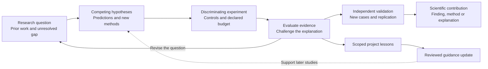

# Toward new MRI discoveries

MRFoundry's long-term aim is to help researchers expand the methods and knowledge available to MRI. A research agent can contribute by connecting ideas across fields, proposing explanations, building experiments and following unexpected results into a better question. The researcher shapes the scientific goal and judges what the evidence establishes.

The package already connects MRI knowledge, scientific tools, checks and project memory. This document sets out how to use those components in a discovery study and what evidence would establish progress. It is a research agenda; the current task-completion results do not measure scientific discovery.

## Two connected loops

The **scientific loop** changes our understanding or our methods. The **self-improvement loop** changes the guidance available to the agent. A better instruction may help a later discovery, but each claim needs its own test. A reproducible methodological gain, an informative refutation and a new mechanism are different scientific outcomes; record which one the experiment supports.

## Start with a question worth resolving

Use the [research brief](templates/research-brief.md) before a substantial search. Identify the nearest prior work, a specific unresolved gap, and why resolving it would matter. Give competing explanations and an observation that would rule out the preferred one. Agree on success criteria and a stopping rule with the researcher.

These illustrative question types connect existing skill areas. They are not claims of new or unsolved problems:

| Question to refine with a researcher | Experiment to design | What a useful contribution could be |
|---|---|---|
| Which joint acquisition and reconstruction choices improve a quantitative estimate at fixed scan time? | Compare against tuned acquisition/reconstruction baselines; fix hardware limits and define accuracy, bias and repeatability endpoints. | A validated trade-off or method that survives new tissue parameters and acquisitions. |
| What explains a reconstruction or parameter-estimation error when acquisition conditions change? | Vary candidate causes separately in controlled simulation; test the resulting prediction on independent acquired data. | An explanation with a useful correction and a documented range of validity. |
| Which next measurement best distinguishes two plausible signal models? | Compare measurement-selection strategies under the same acquisition budget, then test model discrimination and parameter recovery. | An experiment-design rule that resolves an ambiguity on new cases. |

An MRI specialist should check the scientific premise and closest methods before a proposal becomes a challenge. The [research-workflow skill](../skills/mri-research-workflow/SKILL.md) supports study design; [sequence design](../skills/pulse-sequence-design/SKILL.md), [reconstruction](../skills/mri-reconstruction/SKILL.md) and the other specialist skills supply implementation knowledge.

## Make the search scientifically useful

1. **Establish the reference point.** Reproduce strong relevant methods, tune them on development data and state the literature-search date. Define a meaningful improvement and all constraints before comparing candidates.
2. **Let the agent propose testable changes.** Each candidate should include a reason it might work, a measurable prediction and a test that could disprove it. Keep the history of candidates and why each was retained or rejected.
3. **Use trustworthy evaluators.** Check exported artifacts, physical constraints and numerical behavior with established tools. Examine whether optimizing the chosen metric exploits a simulator assumption or sacrifices another endpoint. Use ablations to identify the source of a gain.
4. **Reserve evidence for confirmation.** Keep final test cases inaccessible during search. Freeze the candidate before evaluating new subjects, acquisitions or simulation conditions. Predefine repetitions, the unit of analysis, uncertainty estimates and how multiple comparisons will be handled; exploratory findings need fresh confirmation.
5. **Account for the whole research process.** Report unsuccessful candidates, tool failures, compute, model calls, elapsed time and human interventions. Match total search and tuning budgets when comparing agents or workflows, and include an expert-led baseline with its resources documented.
6. **Validate the contribution.** Have an independent researcher assess the closest prior work and reproduce the central result. Claims about acquired MRI need appropriate acquired-data validation; simulation evidence supports the tested model and conditions. Release a runnable evidence package when permissions allow.

Public benchmark tasks can help develop execution skills. A discovery evaluation needs separate, protected confirmation cases and a prior-art review. Maintain a record of which data and feedback entered project memory; lessons from the final evaluation must not enter a later run presented as held out.

## What to measure next

The current [MRI Agent Bench comparison](https://github.com/KeWang0622/MRIAgentBench/blob/main/docs/RESULTS.md) measures task completion with and without MRFoundry. The proposed next stages ask whether agents improve a method under a fixed budget and whether they contribute independently validated new knowledge. Review **validity, novelty, scientific importance, generalization, reproducibility and research cost** separately. A persuasive explanation or a single aggregate score cannot settle all of them.

For MRFoundry, compare the same model and tools with and without the package. To test RSI, separately compare fresh memory with permitted prior lessons, and frozen guidance with reviewed revisions. Declare the information available to every arm. The [self-improvement guide](SELF-IMPROVEMENT.md#evaluating-an-improvement) describes these controls.

## Design lessons from AI-for-science research

These sources inform the agenda; the proposed MRI study design above is our synthesis.

- **Novikov A, et al. “AlphaEvolve: A coding agent for scientific and algorithmic discovery.” arXiv:2506.13131 (2025).** [Paper](https://arxiv.org/abs/2506.13131). Its code-search loop uses evaluator feedback to refine candidates. For MRI, the evaluator must test the scientific objective and relevant physical constraints.
- **Gottweis J, et al. “Accelerating scientific discovery with Co-Scientist.” Nature 2026;655:487–496. doi:10.1038/s41586-026-10644-y.** [Paper](https://www.nature.com/articles/s41586-026-10644-y). Hypothesis generation and refinement are paired with experimental validation. This motivates checking proposed explanations with new evidence beyond agent critique.
- **Starace G, et al. “PaperBench: Evaluating AI's Ability to Replicate AI Research.” arXiv:2504.01848 (2025).** [Paper](https://arxiv.org/abs/2504.01848). Expert-developed rubrics make research replication assessable. Replication is a valuable foundation; discovery additionally requires a prior-art and scientific-contribution assessment.

Primary records checked 12 November 2026.
