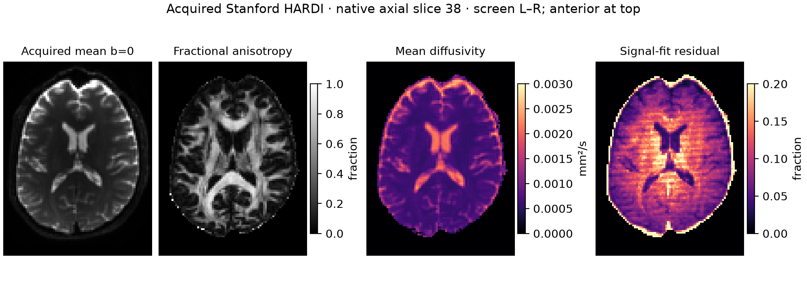

# Supporting Information S2

Recorded MRI workflow evidence

This supplement preserves the numerical methods, checks and limitations of the researcher-supervised demonstrations. It reports saved artifacts; no experiment, reconstruction or model was rerun for this manuscript revision. These examples have no matched unguided baseline and are distinct from the offline evaluation in Supporting Information S1.

## S2.1 Sequence design, simulation and provenance

The recorded request was to design a golden-angle radial gradient-echo (GRE) sequence in PyPulseq and simulate it first. User-accepted defaults were a 220-mm field of view, 64 samples per spoke, 5-mm slice, 10-degree nominal flip, TE/TR 5/15 ms, and assumed per-axis limits of 32 mT/m and 130 T/m/s. The implementation used 128 sampled spokes, 200 dummy excitations, a 111.246-degree increment modulo 180 degrees, 117-degree RF spoiling with matched ADC phase, and 40-microsecond ADC dwell.

PyPulseq 1.5.0.post1 constructed the RF, gradient and ADC events, checked timing and integrated trajectories, wrote the Pulseq file, reopened it and repeated the checks. After researcher feedback, an initial custom simulator was superseded by official KomaMRI. The retained implementation ran the official EPI smoke example, imported the actual exported GRE, and simulated all 328 excitations on a 13,497-spin extruded 2D brain phantom. It used 409 in-plane locations on an 8-mm lattice, replicated at 33 z positions (0.25-mm spacing, -4 to +4 mm). Halving the RF integration step from 10 to 5 microseconds tested temporal sensitivity on the same phantom.

| Recorded check | Value | Reference or scope |
| --- | --- | --- |
| TE / TR | 5.000 / 15.000 ms | Readback; target 5 / 15 ms |
| Timing errors | 0 | PyPulseq readback |
| Peak per-axis gradient | 12.735 mT/m | Configured limit 32 mT/m |
| Peak per-axis slew | 125.266 T/m/s | Configured limit 130 T/m/s |
| Export/prewrite trajectory difference | 0.00162 cycles/m | Maximum absolute coordinate difference |
| Retained ADC samples | 8,192 | Finite and nonzero; 128 x 64 |
| RF-step signal change | 0.07096% | L2(S5us - S10us) / L2(S5us) |

The sequence was designed and simulated on 23 September 2026. On 28 October, the unchanged exported file and saved simulation arrays were audited for the figure. The waveform shows the first three sampled repetitions, starting after the 200 dummy excitations; total sequence duration is 4.92 s. RF display is magnitude, not phase. The pulse-sequence skill hash records a read during this later audit; it does not establish retrieval of that skill during the original design. Actions summarized in Figure 3 derive from retained scripts, reports and project records, not a verbatim autonomous-agent transcript.

These checks do not establish spatial or full physical-model convergence, scanner readiness, SAR/PNS safety, gradient heating, vendor-interpreter compatibility, or diagnostic image quality. The model used uniform transmit/receive sensitivity without gradient delay, eddy currents or motion.

Sources: [PyPulseq](https://doi.org/10.21105/joss.01725), [Pulseq](https://doi.org/10.1002/mrm.26235), [KomaMRI](https://doi.org/10.1002/mrm.29635), [golden-angle sampling](https://doi.org/10.1109/TMI.2006.885337). Frozen evidence: sequence-audit.json and koma_report.json; their hashes and numerical pointers are retained in supporting-numerical-evidence.json and supporting-numerical-provenance.md.

---

# Acquired-data reconstruction

## S2.2 Inputs, solver revision and complete comparisons

The M4Raw Brain v1.6 acquisition is a four-channel, 0.3-T T2-weighted human brain measurement; one fixed axial slice (index 8) was used. The source checksum matched the author manifest. The official array contract identified the last axis as phase encoding despite conflicting legacy XML labels. The stored 256-column grid contained 195 acquired phase-encoding lines. Centered-IFFT root-sum-of-squares (RSS) agreed with the provider image to relative L2 error 8.85 x 10^-8. That is an input/transform check; RSS remains a noisy, available-source reference, not complete or noise-free ground truth.

Two retrospective masks retained 110 or 67 acquired lines, including 24 central calibration lines. Effective R is 195 divided by retained lines: 1.77 and 2.91. The initial calculation already used 195; there is no recorded correction of an executed 256-based acceleration estimate. SigPy 0.1.27 used shared ESPIRiT maps (calibration width 24, kernel 6, threshold 0.02, crop 0.95). Initial L2-SENSE used weight 0.001 and 120 iterations. Its unfavorable outputs were retained. Following inspection and calibration diagnostics, a bounded revision reused the maps and applied fixed L1-wavelet settings to both masks: weight 0.01, db4 wavelets, 200 iterations, seed 0, without a per-mask parameter search. Separate 400-iteration runs checked stability. Calibration exploration did not establish a validated encoding model or isolate the cause of the residuals. Some exploratory settings modestly reduced a diagnostic residual, but none was adopted; the final comparison retained the original maps and acknowledged unresolved data agreement. Original diagnostics, scripts and exact public input identities are in the [demonstration evidence directory](https://github.com/KeWang0622/MRFoundry/tree/main/paper/evidence/demonstrations).

| Saved metric (%) | 110 lines | 67 lines |
| --- | --- | --- |
| Initial SENSE magnitude discrepancy | 43.55 | 70.26 |
| Final L1 magnitude discrepancy | 30.33 | 33.62 |
| Zero-filled RSS magnitude discrepancy | 21.24 | 28.92 |
| Initial SENSE sampled-data residual | 30.08 | 21.87 |
| Final L1 sampled-data residual | 30.88 | 24.84 |
| Initial SENSE withheld-source residual | 103.11 | 202.50 |
| Final L1 withheld-source residual | 85.72 | 91.38 |
| Final L1 200-to-400-iteration change | 0.0477 | 0.0741 |

Magnitude discrepancy is full-matrix L2(|x| - RSS) / L2(RSS), with no fitted image gain. Data residuals compare predicted and observed complex k-space on the sampled or withheld source mask, normalized by that mask's observed-data norm. Withheld lines do not enter the solve. Iteration change is L2(x400 - x200) / L2(x400). All displayed reconstructions share the source-RSS normalization and window; the RSS peak supplies a common scalar, but the reference magnitude is not a spatial target for the inverse solve.

L1 reduced magnitude discrepancy relative to the initial SENSE outputs, yet zero-filled RSS remained closer to the noisy reference and sampled-data residual increased. Tiny iteration changes do not establish anatomical fidelity or resolve substantial residuals. Noise covariance, prewhitening and biological validity were not independently assessed. A source-derived ROI was explored after output inspection and remains a descriptive diagnostic, not a prespecified primary endpoint. The acquired-support finding was saved as a scoped lesson; subsequent retrieval or benefit was not measured.

Sources: [M4Raw paper](https://doi.org/10.1038/s41597-023-02181-4), [M4Raw data](https://doi.org/10.5281/zenodo.8056074), [release format](https://huggingface.co/datasets/mylyu/M4Raw_brain/blob/v1.6.0/H5_FORMAT.md), [SigPy](https://cds.ismrm.org/protected/19MProceedings/PDFfiles/4819.html), [ESPIRiT](https://doi.org/10.1002/mrm.24751). Retained records: initial-sense-report.json, report.json, run_m4raw.py and finalize_evidence.py. The latter's formulas and final report hashes are documented in supporting-numerical-provenance.md.

---

# Diffusion model and fit checks

## S2.3 Independent acquired-data demonstration

Stanford HARDI supplied one independent acquired subject: 81 x 106 x 76 voxels at 2-mm isotropic spacing, with 10 b=0 and 150 b=2000 s/mm^2 volumes. This dataset is neither an output of the radial GRE simulation nor the M4Raw reconstruction. Source checksums, finite values, image/gradient counts and direction norms were checked. Direction norms ranged from 0.999992 to 1.000006. The source affine indicated RAS axes. Provider preprocessing was reported as motion correction to mean b=0 using SPM/mrVista; it was not independently verified or repeated.

DIPY 1.12.1 fitted weighted-least-squares diffusion tensors on fixed zero-based axial slices 30, 38 and 46. For signal prediction, S0 was set to the mean of the ten b=0 volumes. A three-dimensional median_otsu mask (radius 3, one pass, dilation 1) was used, with holes filled per displayed slice. Fractional anisotropy (FA) and mean diffusivity (MD, mm^2/s) maps were saved together with residual maps computed from predictions across all 160 volumes. MD finiteness and saved FA finiteness/range checks passed; the FA check followed numpy.nan_to_num, so raw FA finiteness was not independently established.

Figure S2.1. Original saved slice-38 display: acquired mean b=0, FA, MD and same-data signal-fit residual. Source pixels and display are unchanged. FA spans 0-1, MD 0-0.003 mm^2/s and residual 0-0.20; these are display ranges, not acceptance thresholds.

| Axial slice (zero-based) | Mask voxels | Median signal-fit residual |
| --- | --- | --- |
| 30 | 4,799 | 10.24% |
| 38 | 4,834 | 8.95% |
| 46 | 4,365 | 9.05% |

Residual is L2(predicted - measured) / max(L2(measured), 1) per voxel across all 160 volumes, in source intensity units. The denominator floor is inactive in all evaluated mask voxels; saved-array norm lower bounds are 50.91, 36.37 and 68.62 for the three slices. These are within-subject measurements, not three independent subjects.

FA and MD summarize the fitted tensor; residuals describe agreement with the same measured data. The b=2000 protocol is not optimal conventional DTI, and preprocessing, susceptibility/eddy correction and b-vector alignment to anatomy were not independently validated. Unit norms and matching volume counts do not establish the gradient frame. No tractography, clinical threshold, biological inference or agent-performance claim is supported.

Sources: [Stanford HARDI](https://purl.stanford.edu/yx282xq2090), [DIPY](https://doi.org/10.3389/fninf.2014.00008), [diffusion tensor model](https://doi.org/10.1016/S0006-3495(94)80775-1), [weighted least squares](https://doi.org/10.1016/j.neuroimage.2006.07.001). The frozen dwi/report.json and run_dwi.py are identified by hashes in supporting-numerical-provenance.md. Full numerical precision and denominator-floor checks remain in supporting-numerical-evidence.json. M4Raw is CC BY 4.0; Stanford HARDI is PDDL 1.0.
